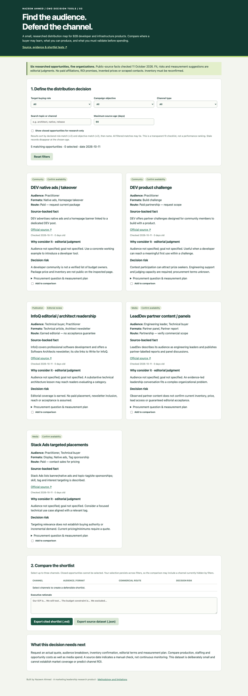

# Developer Channel Atlas

A narrow, cited buyer-channel research product for B2B developer and infrastructure marketing. It helps a CMO select distribution opportunities that fit a buying role and campaign objective, then ask the questions needed before committing budget.

**[Live demo](https://zandemha2025.github.io/developer-channel-atlas/)** · Built by Nazeem Ahmed. Six opportunities across five organizations. No paid affiliations, invented prices, personal contacts, reach guarantees or business results.



## The executive decision

Where should an infrastructure product reach practitioners, technical buyers or engineering leaders—and what would make that investment defensible?

Intersect audience, objective, channel type, keyword and source freshness. Compare up to three opportunities with equivalent audience/format, route and risk fields. Each entry separates an official-source fact from editorial fit, includes a check date, and supplies a procurement question and measurement plan. Export a cited decision shortlist with your rationale, or download the complete JSON dataset.

KubeCon NA 2026 is marked **Closed** based on its actual official page. It is excluded by default and cannot enter the actionable shortlist. Other paid/partner opportunities say **Confirm availability**; the tool does not imply current bookable inventory.

## Sources and method

Manually inspected on **2026-10-11**:

- [DEV advertising](https://dev.to/advertise): native ads, takeover and product challenges.
- [Stack Ads](https://stackoverflow.co/advertising/): targeted placements, sponsorship formats and quote-based current pricing.
- [LeadDev](https://leaddev.com/): engineering-leadership positioning and observed partner-labelled reports/panels; availability is unconfirmed.
- [InfoQ](https://www.infoq.com/): professional development/architecture publication, architect newsletter and Write for InfoQ route. Earned editorial, with no acceptance guarantee.
- [KubeCon + CloudNativeCon NA sponsor page](https://events.linuxfoundation.org/kubecon-cloudnativecon-north-america/sponsor/): current edition and explicitly closed sponsorship opportunities.

Audience/goal mappings, fit and risk notes are editorial judgments from the inspected source context, not provider certifications or measured performance. Source age is calculated at runtime from the actual current date. Records older than the selected threshold, or future-dated records, are excluded. This does not continuously monitor providers.

Matches score +2 for selected audience and +2 for selected objective, then sort by name. With both intersection filters applied, results may tie; this is a fit checklist, not a performance league table. Selection persists across filters but remains browser memory; exported files are the persistence mechanism.

## Implementation and verification

Buildless HTML/CSS/ES modules, no dependencies or API keys. `data.js` is the reviewable dataset; `shortlist.js` contains deterministic filtering, freshness, scoring and export rules. User rationale is locally exported; dynamic HTML is escaped. No scraping, contact enrichment, tracking or outreach.

```sh
npm test
npm start
# open http://localhost:8103
```

Seven tests verify unique cited records, closed exclusion, filter intersection, query/type filtering, age boundaries, deterministic ranking and export limitations. CI runs on pushes/PRs. [Actual browser QA](docs/QA.md) · [two-minute demo](docs/DEMO.md).

## Real limitations

The dataset is small and does not claim full market coverage. Multiple opportunities can share a provider. Actual audience composition, pricing, inventory and procurement terms need reconfirmation. Provider statements are not independent proof of effectiveness. Do not infer channel ROI; compare total creative, staffing and opportunity costs and predeclare qualified outcomes before any purchase.

## Shipping record

New public portfolio project with genuine incremental October 2026 commits; no fabricated history or usage. GitHub Pages static hosting. MIT license; provider trademarks remain their owners' property.
